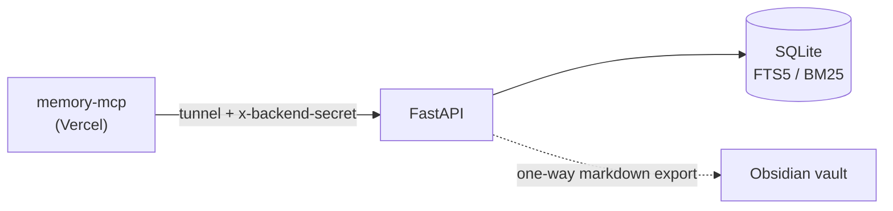

# memory-backend

The storage service behind [memory-mcp](https://github.com/hitrohitro/memory-mcp), a shared long-term memory for AI assistants. It is a plain JSON API (FastAPI + SQLite) that runs in Docker on my home server. The MCP/OAuth front door lives in the other repo and forwards tool calls here.



## Features

- **Full-text search**: SQLite FTS5 with BM25 ranking, kept in sync by insert/update/delete triggers. Free-text queries are sanitized into safe prefix queries.
- **Credential filter**: writes are rejected (422) if the text looks like a private key, API key, token, or `password=...` pair.
- **Auth**: every route except `/health` requires a shared secret header, compared in constant time. A wrong secret returns 404, so the API doesn't reveal itself.
- **Rate limit**: 60 authenticated requests per minute by default (in-memory, single process).
- **Obsidian export**: each entry is written as a markdown note with front matter and `[[wikilinks]]` to machine hubs, tag hubs, and related entries, so the graph view shows connections. Writes are atomic (temp file, then replace), so file-sync tools never see a half-written note. The export is one-way and the database stays the source of truth.

## API

All routes except `/health` need the header `x-backend-secret: <BACKEND_SECRET>`.

| Route | Purpose |
|---|---|
| `POST /save` | Create an entry (`title`, `summary`, optional `details`, `tags`, `machine`, `source`) |
| `POST /search` | Full-text search (`query`, optional `limit`) |
| `GET /recent?n=10&machine=` | Most recently updated entries |
| `GET /entry/{id}` | One entry |
| `POST /update` | Edit an entry by `id` |
| `POST /reexport` | Rebuild the whole markdown vault from the database |
| `GET /health` | Unauthenticated liveness check |

## Configuration

| Variable | Default | Purpose |
|---|---|---|
| `BACKEND_SECRET` | required | Shared secret, 32+ characters; the server refuses to start without it |
| `DB_PATH` | `memory.db` | SQLite file location |
| `RATE_LIMIT_PER_MIN` | `60` | Authenticated requests per minute |
| `VAULT_DIR` | unset | If set, entries are also exported as markdown notes here |

## Run it

With the published image:

```bash
export BACKEND_SECRET=$(openssl rand -hex 32)   # save this somewhere
mkdir -p data
docker run -d --name memory-backend -p 127.0.0.1:8787:8787 \
  -v "$PWD/data:/data" -e DB_PATH=/data/memory.db -e BACKEND_SECRET \
  ghcr.io/hitrohitro/memory-backend:latest

curl localhost:8787/health
curl -X POST localhost:8787/save \
  -H "x-backend-secret: $BACKEND_SECRET" -H "content-type: application/json" \
  -d '{"title":"Tailscale","summary":"mesh vpn setup","tags":"network","machine":"balthasar"}'
```

Or with Compose: `cp .env.example .env`, put a real secret in `.env`, `mkdir -p data ~/memory-vault`, then `docker compose up -d`. The port is published on localhost only, so point a tunnel at it instead of exposing it directly.

## Development

```bash
pip install -r requirements.txt pytest httpx
pytest
```

CI runs the tests and publishes the image to `ghcr.io` on every push to `main`.
