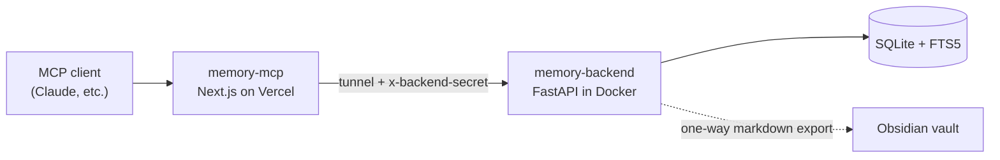

# memory-backend

A small self-hosted memory service for AI assistants: a FastAPI + SQLite store with full-text search, credential-leak filtering, and a one-way export to an Obsidian vault.

It is the storage half of a cross-LLM memory system. The MCP front door (OAuth + tool definitions) lives in [memory-mcp](https://github.com/hitrohitro/memory-mcp) and forwards tool calls here. This service is a plain JSON API and doesn't speak MCP itself.

## Architecture



## Features

- **Full-text search** with SQLite FTS5 and BM25 ranking. The index is kept in sync by triggers, and free-text queries are sanitized into safe prefix-match FTS expressions.
- **Credential filter:** writes that look like they contain private keys, API keys, tokens, or `password=...` style strings are rejected with a 422.
- **Auth:** every route except `/health` requires the `x-backend-secret` header, compared in constant time. A wrong secret returns `404`, so the API doesn't reveal itself.
- **Rate limiting:** a global in-memory limit (default 60 requests/minute). It resets on restart and is not per-client.
- **Fail-fast config:** the service refuses to start unless `BACKEND_SECRET` is at least 32 characters.
- **Obsidian export (optional):** every entry is written as a markdown note with `[[wikilinks]]` to machine and tag hub notes plus related entries, so the graph view shows connections. Writes are atomic (temp file, then replace), so file-sync tools never see a half-written note. The export is one-way: the database is the source of truth and edits to the notes are not read back.
- **WAL mode** SQLite, with a Docker health check and a non-root user in the compose setup.

## API

All routes need the header `x-backend-secret: <secret>`, except `/health`.

| Method | Route | Purpose |
|---|---|---|
| GET | `/health` | Liveness check (no auth) |
| POST | `/save` | Create an entry: `title`, `summary`, optional `details`, `tags`, `machine`, `source` |
| POST | `/search` | Full-text search: `query`, optional `limit` (1-25) |
| GET | `/recent` | Latest entries: `n` (1-50), optional `machine` filter |
| GET | `/entry/{id}` | Fetch one entry |
| POST | `/update` | Partially update an entry by `id` |
| POST | `/reexport` | Rebuild the whole Obsidian vault from the database (requires `VAULT_DIR`) |

## Configuration

| Variable | Default | Purpose |
|---|---|---|
| `BACKEND_SECRET` | none, required | Shared secret, 32+ characters |
| `DB_PATH` | `memory.db` | SQLite file location. Set it to a mounted volume, e.g. `/data/memory.db` |
| `RATE_LIMIT_PER_MIN` | `60` | Global request limit |
| `VAULT_DIR` | empty (off) | Enables the markdown export to this directory |

## Run it

Generate a secret and keep it, because the MCP front door needs the same value:

```bash
export BACKEND_SECRET=$(openssl rand -hex 32)
```

**Docker (published image):**

```bash
docker run -d --name memory-backend \
  -p 127.0.0.1:8787:8787 \
  -v memory-data:/data \
  -e DB_PATH=/data/memory.db \
  -e BACKEND_SECRET=$BACKEND_SECRET \
  ghcr.io/hitrohitro/memory-backend:latest
```

**Docker Compose:** copy `.env.example` to `.env`, set `BACKEND_SECRET`, then:

```bash
docker compose up -d --build
```

The compose file publishes the port on `127.0.0.1` only. Point a tunnel (Cloudflare Tunnel, Tailscale Funnel, etc.) at it rather than exposing the port directly.

**Try it:**

```bash
curl localhost:8787/health

curl -X POST localhost:8787/save \
  -H "x-backend-secret: $BACKEND_SECRET" -H "content-type: application/json" \
  -d '{"title":"Tailscale setup","summary":"Mesh VPN across the home servers","tags":"networking","machine":"balthasar"}'

curl -X POST localhost:8787/search \
  -H "x-backend-secret: $BACKEND_SECRET" -H "content-type: application/json" \
  -d '{"query":"tailscale"}'
```

## Tests

```bash
pip install -r requirements.txt pytest httpx
pytest -q
```

CI runs the tests and publishes the image to `ghcr.io/hitrohitro/memory-backend` on every push to `main`.

## Stack

Python 3.12, FastAPI, SQLite (FTS5/BM25), Docker, GitHub Actions.
